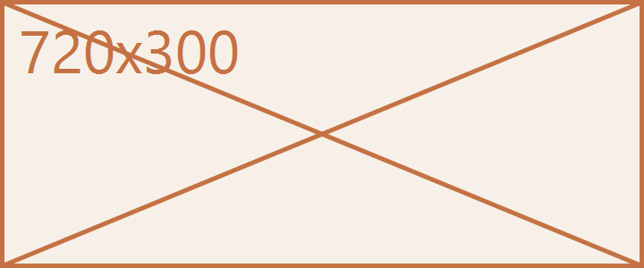

# HTML in the page

A formula written the HTML way sits where a formula's digits sit: H<sub>2</sub>O and
E = mc<sup>2</sup>, beside the citation mark[^1] the page already raises. The two
scripts are one mark worn two ways, so they are set at one size.

## The marking is worn, never read

Tags dress their words and leave no trace of themselves: <b>bold</b>,
<strong>strong</strong> (the same cloth), <i>slanted</i>, <em>emphasised</em>,
<code>inline_code()</code>, and <del>struck through</del>. A <span>span</span>, an
<a href="https://example.com/page">anchor</a>, and a <mark>mark</mark> ask for something
the page has no answer for, so their words stay and their markup goes.

Tags that part two fields leave two fields rather than one word: <td>12</td><td>34</td>
parts two numbers, while <td>数据</td><td>字段</td> keeps its words joined when both
sides are CJK. And a <br> keeps the line
break it stands for.

<div>
  A wrapper names nothing the page has an answer for: its words read plainly and the
  tag itself is never shown, nor is the one that closes it. The markup inside a block
  still dresses: <em>emphasis</em> and H<sub>2</sub>O read as they do in prose.
</div>

The two constructions below are shown whole, because their shape is the point -- what a
reader is owed here is the source their page was built from:

<table>
  <tr><td>a</td><td>b</td></tr>
  <tr><td>c</td><td>d</td></tr>
</table>

<details>
  <summary>Kept whole</summary>
  A disclosure's shape is also its point.
</details>

## Figures

A figure stands inside the sentence:  and
beside it Markdown's own  keeps its box either way.




The wide figure is 720 px across, wider than the column; at its author's Typora
`zoom:87%` it lands at 87% of its natural size, which is no longer wider -- the
author's sizing happens first, and the column only ever shrinks what is left.

## Code is not markup

A fence keeps its characters, tags and all:

```html
<b>shown</b> as <code>written</code>
```

and inline `<sub>` is the word, not a subscript.

[^1]: the note behind the citation-shaped mark
