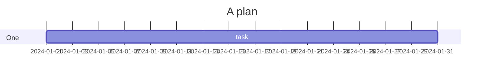
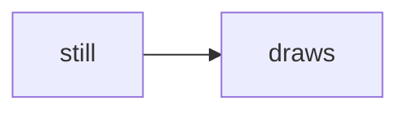

# Mermaid that cannot be drawn

A fence that does not parse stays a code block, with the reason above it:

```mermaid
flowchart TD
  a[oops --> b
```

And one that names a diagram this reader does not draw:



The document keeps going after both, and a readable fence after the failures
still draws:


