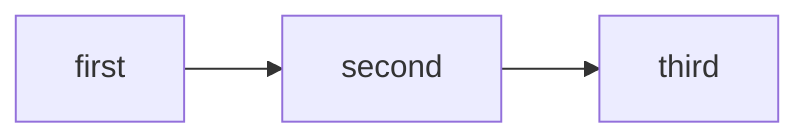

# Flowcharts

Every node shape this reader knows, one arrow style per pair, edge labels in
both positions, a subgraph, and a self-loop.

```mermaid
flowchart TB
  a[Rectangle] --> b(Rounded)
  b --> c([Stadium])
  c --> d[[Subroutine]]
  d --> e[(Cylinder)]
  e --> f((Circle))
  f --> g{{Hexagon}}
  g --> h{Diamond}
  h --> i[/Parallelogram/]
  i --> j>Asymmetric]
  k -->|label with pipes| l
  l --- m
  m -.-> n
  n ==> o
  o <--> p
  p o-- q
  q x-- r
  s -- a label between the dashes --> t
  u --> u
  subgraph inner[A subgraph]
    v --> w
    w --> v
  end
```

A second fence in the same document exercises the left-to-right direction:



Prose after the diagrams proves the two ends of the band update: the document
keeps flowing below whatever was drawn.
